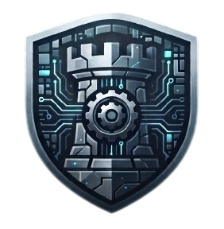

<div align="center">



# San Jacinto

[]()
[]()

[]()

Development, testing, tuning, and analytics framework for the **Tomahawk chess engine**

Tomahawk itself is maintained separately

See `docs/` for more info.

</div>

---

# Overview

San Jacinto provides the infrastructure surrounding engine development:
- SPRT strength testing
- tournament automation
- SPSA parameter tuning
- NNUE tooling
- game/search telemetry processing
- database pipelines
- analytics dashboards

---

## Repository Relationship

```
projects/
│
├── tomahawk/
│   └── Chess engine (C++ / UCI)
│
└── san-jacinto/
    └── Development framework (this repo)
```

San Jacinto communicates with Tomahawk through the UCI protocol and manages the experimentation lifecycle around engine development.

---

# Features

## Data Pipeline

Located in:

```
data/
```

The data pipeline handles engine statistics, game records, and analytics.

Collected stats include: fail high rates, re-search rates, function call times, node counts, etc.

OLTP --> OLAP framework with raw database collection of engine log files, and analytics database for advanced stats

Structure:

```
data/
├── databases/
├── etl/
├── transforms/
├── dashboard/
├── openings/
├── tests/
└── ratings.py
```

### Database schema (new statistics, old data)

The raw database's schema is the base tables in `data/databases/init_raw_db.py` plus every migration in `data/databases/migrate_schema.py`. Each migration is applied once and recorded in the database's `schema_migrations` table.

- **Applied automatically:** every program that writes to the database applies pending migrations first, so an existing database is upgraded in place. `init_raw_db` applies all of them, and re-applies whatever is missing of applied ones, so `--delete` followed by init gives the full current schema.
- **Old rows are kept:** migrations only add tables, indexes and nullable columns (and rename `nmp_fail`, which became `nmp_failhigh` in July 2026, keeping its data). A column added later is NULL for earlier rows: "not measured", not 0. The same holds for a field an engine doesn't log.
- **Nothing logged is lost:** a log field without a column yet, or with a value that doesn't fit its column's type, is kept in the row's `extra_fields` (JSON) and reported. Adding the column later fills it from there.
- **Safe:** each migration is one transaction, and concurrent programs apply it once. `--delete` drops everything in one transaction. Programs wait up to 30 minutes for another program's write (e.g. an SPRT loading telemetry) instead of failing with "database is locked".

To collect a new engine statistic (e.g. correction history):

1. Log it from Tomahawk. Name it `x` per search, `itdepth_x` per iteration, `treedepth_x` per tree depth.
2. Add a `Migration` to `MIGRATIONS` in `migrate_schema.py` that adds column `x` (nullable) to `searches`, `searches_by_iteration` or `searches_by_tree_depth`. Type it like the values: `INTEGER` for counts, `REAL` for ratios.

That's all:
- **ETL:** stores each log field in the column of the same name.
- **Analytics:** `load_analytics` adds new raw columns to its tables.
- **Views:** to chart the statistic on the dashboard, add it to the views (`data/transforms/sql`).
- **Rules:** never add columns to init's `CREATE TABLE`s, and never edit an applied migration; add a new one. `data/tests` checks this (`python -m unittest discover -s data/tests -t .`).

Before the first program run on an existing database, back it up and preview the upgrade:

```
python -m data.databases.migrate_schema --dry-run
```

The dry run also lists the tables and columns your database has beyond the current schema. These are kept as they are; a column of an older layout may hold data under a name that has since changed.

### Engine identity (build provenance)

An engine is its build, not its version string: `engine_key` = binary SHA-256 + the SHA-256 of the NNUE net it loads (Tomahawk reads its net from a file, so the same binary with another net is another engine). `release.py` writes `<exe>.build.json` next to every build: git commit, branch, dirty flag and diff hash, build type, compiler and flags. Registration stores all of it in `engines`, and every runner (SPRT, tournament, STS, perft) looks engines up by key.

- **Hand-built binaries:** `python -m data.etl.provenance stamp <exe> --source ../tomahawk --build-type DEV`. Inspect one with `... show <exe>`.
- **SPRT telemetry:** each run's engines log into their own folders (`<logroot>/<run>/<side>`), so search and game logs belong to the right build even when both report the same version. Loaded logs are deleted. If loading fails, the logs are kept; load them later with `python -m tests.sprt --retry-ingest <logroot>/<run>`.
- **Old rows:** a row registered before keys existed is adopted by `<version>.exe` (`<version>` on Linux/macOS; how `release.py` names builds) if it is the only such row. Other builds reporting that version get their own row.
- **Public snapshot:** `data/databases/export_public.py` publishes the hashes and the commit, but not file paths, branch names or the provenance record. Folders are also stripped from paths in engine descriptions.

### Ratings

`data/ratings.py` fits logistic Elo (maximum likelihood, 95% intervals) over every stored rating game per category. Categories are the time-control classes, fixed limits such as `nodes=5000`, and multi-threaded play as its own class, e.g. `blitz@T4`. Every pairing result goes into `match_results`; each fit lands in `rating_fits`/`ratings` and is mirrored into `engine_ratings` for the dashboard. SPRT results are recorded but left out unless `--include-sprt`, because early stopping inflates the Elo of tests that pass.

- **Scale:** each fit keeps the previous fit's anchor engine and Elo, so ratings stay comparable from run to run. A category's first fit anchors the oldest engine of the largest connected group, at its current rating (else 1500). `--anchor ID` moves the anchor to another engine, also at its current rating unless `--anchor-elo` is given.
- **Unconnected engines:** engines with no games linking them to that group are fitted in their own component and are not mirrored.

```
python -m data.ratings show --tc blitz          # version history: Elo, +-, gain over the previous version
python -m data.ratings fit [--tc ...] [--include-sprt] [--anchor ID]
python -m data.ratings backfill-sprt            # copy existing SPRT rows into match_results
```

---

## Testing

Located in:

```
tests/
├── bench.py
├── compare.py
├── perft.py
├── sprt.py          SPRT (pentanomial); --tc / --time / --depth / --nodes, --threads, --tb
├── smp.py           Lazy SMP strength: Elo of 2 vs 1, 4 vs 2 threads ... (fixed length)
├── tournament.py    progression test: gauntlet vs earlier versions, global rating refit
├── mistakes.py      mine past mistakes (Stockfish-verified) into an EPD suite
├── sts.py           EPD suites (STS, the mistake suite); --depth / --time / --nodes
└── release.py       build, register, test, rate and tune a new version in one command
```

- **Fixed nodes** (`--nodes N` in sprt, sts and both tuners) take hardware speed out of eval/NNUE tests. Every engine is checked first: one that ignores `go nodes` is refused, because the test would silently measure something else. Tomahawk has no node limit yet; `SearchLimits` only knows time and depth.
- **SMP:** `python -m tests.smp --engine X --threads 1 2 4 --tc 10+0.1 --pairs 200` measures what threads are worth. To check that a search patch still helps with threads, run the SPRT multi-threaded: `--threads 4`, or `release.py --sprt_threads 1 4` to gate at both.
- **Progression** (`tests/tournament.py`, `release.py --tournament`):
  - The candidate plays a fixed number of opening pairs against each earlier version; `--round-robin` also plays the opponents against each other.
  - Each pairing is reported as pentanomial Elo with a 95% interval, and the global fit is redone with the new games.
  - Opponents are one build of each earlier version: the Prod build if there is one, else the newest. The candidate's own version and scratch versions (dev, test, debug) are skipped.
  - Builds are found by their registered binary (and net) hash, so a rebuilt exe is never mistaken for an old version.
  - Each run's PGN is kept in `logs/tournament_results/`.
- **Mistakes:** `python -m tests.mistakes [--player Candidate]` mines the SPRT and tournament PGNs:
  - Stockfish screens every move and verifies candidates at depth with MultiPV. A position is kept when the played move loses at least 15 win% points.
  - The position goes into `logs/mistakes/mistakes.epd`, with `bm` = the good moves and `am` = the mistake.
  - Replay it per version with `python -m tests.sts --sts logs/mistakes/mistakes.epd --depth 10` to track how many past mistakes are fixed.
  - Re-running over the same logs adds nothing.
- **Tablebase adjudication:** `--tb DIR` (sprt, tournament, smp, release). Only the WDL files are needed: the 3-4-5 piece set is 378 MB (https://tablebase.lichess.ovh/tables/standard/3-4-5-wdl/). A folder without `*.rtbw` files is refused before the run.

### CPU pinning

Games (SPRT, tournaments, tuning) are pinned to CPUs by default. Each concurrent game gets its own slot: `--threads` CPUs (default 1), taken in the order Tomahawk's `Affinity` code reports on `uci` (P-cores first, SMT siblings last). Both engines of a game take turns on the same CPUs. Inside the slot, the engine places its own search threads.

- **One thread:** fastchess `-use-affinity` pins each game to one CPU.
- **More threads** (SPRT `--threads N`): each slot runs its own fastchess process, started on the slot's CPUs, and both engines inherit them. fastchess 1.8.2 can only pin one CPU per game.
- **Unpinned:** builds that don't report their CPU order (they pin themselves at startup) and macOS run unpinned. `--no-pin` turns pinning off. Unpinned multi-threaded SPRT games run the engines with `Affinity=none`.
- **Concurrent runs** pin to different CPUs: each run claims its CPUs with a lock file under the (per-user) temp folder, held by the run's Python process until the run ends. If you kill only `python.exe`, also end its `fastchess` processes; they keep running and would share CPUs with the next run. To give a run a specific part of the machine, start it restricted to those CPUs, e.g. `start /affinity F0 python -m tests.sprt ...` or `taskset -c 4-7 python -m tests.sprt ...`.

See [utils/cpu_slots.py](utils/cpu_slots.py).

---

## Tuning

Located in:

```
tuning/
```

Contains tools for automated parameter optimization.

Current tools:

- SPSA tuning
- CMA-ES tuning
- UCI parameter generation

Used for optimizing search parameters such as:
- LMR reductions
- pruning margins
- evaluation constants
- move ordering parameters

---

# NNUE Tools

Located in:

```
nnue/
```

Contains utilities for:

- NNUE data preparation
- training workflows
- network management: `nnue/registry.py` ties each net (by file hash) to its training run, validation loss and the Elo of the engines that load it

```
python -m nnue.registry scan                     # register every checkpoint (train.py does this after training)
python -m nnue.registry report --tc blitz        # val loss vs Elo per net, with Spearman/Pearson correlation
python -m nnue.registry match --engine X --net-a A.bin --net-b B.bin --nodes 50000 --pairs 200
```

`match` loads two nets into one binary through a UCI option, so the engine must declare it on plain `uci`. Tomahawk declares `nnue_weight_file` only for `uci_dev`, and it takes a name rather than a path.

The trained networks are consumed by Tomahawk.

---

# Requirements

## Python

Recommended:

```
Python >= 3.11
```

Install dependencies:

```bash
pip install -r requirements.txt
```

## External Dependencies

Required:

- Tomahawk engine repository
- [fastchess](https://github.com/Disservin/fastchess) (game manager for SPRT, tournaments, and tuning)
- Stockfish (for comparison/testing, and to verify mined mistakes: `--stockfish` or `STOCKFISH_PATH`)
- Python data stack
- Optional: Syzygy WDL tablebases for adjudication (`--tb`)

fastchess is the `libs/fastchess` submodule. The scripts expect the binary at
`libs/fastchess/fastchess.exe` (`libs/fastchess/fastchess` elsewhere); override it with `--fastchess`.
Build it with `make -j` in `libs/fastchess` (MSYS2/MinGW on Windows), or place a
[release binary](https://github.com/Disservin/fastchess/releases) there:

```bash
git submodule update --init libs/fastchess
make -C libs/fastchess -j
```

---

# Configuration

San Jacinto expects Tomahawk to exist alongside this repository:

```
projects/
├── tomahawk/
└── san-jacinto/
```

Engine paths should be configured through the project configuration system.

---

# Development Workflow

Typical engine development cycle:

```
Modify Tomahawk
        |
        v
Build engine
        |
        v
Run San Jacinto tests
        |
        v
SPRT / Tournament validation
        |
        v
Analyze results
        |
        v
Tune parameters
        |
        v
      Repeat
```

---

<div align="center">

Built with Python and a lot of data.

</div>
