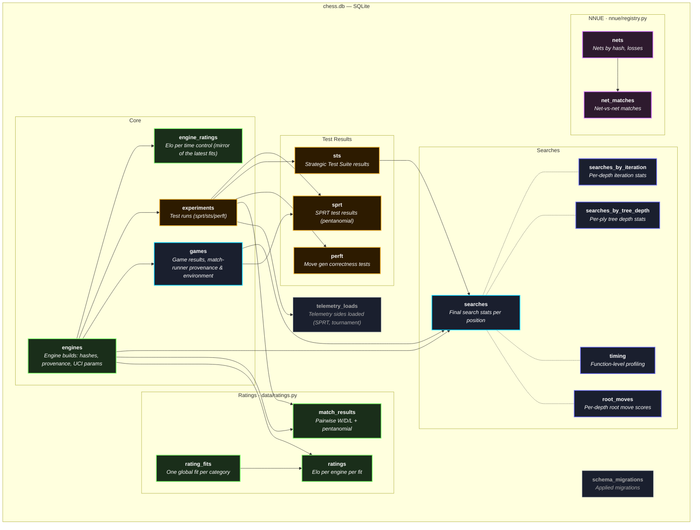
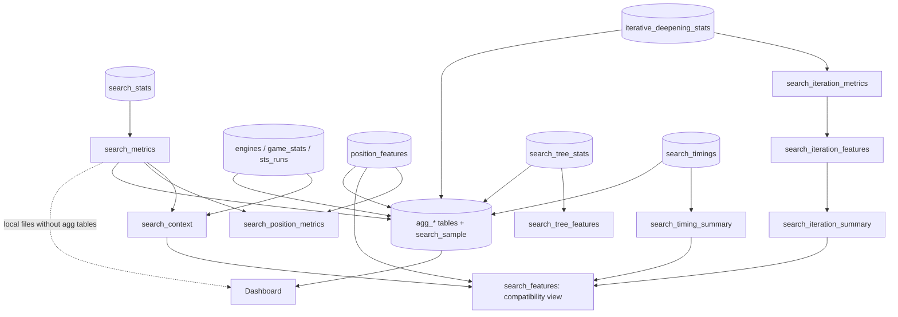

# Database Schemas

## Raw Layer — SQLite (`chess.db`)

| Group | Tables | Row Scale |
|-------|--------|-----------|
| Core entities | `engines`, `experiments`, `engine_ratings` | 10s |
| Game data | `games` | 1000s |
| Search data | `searches`, `searches_by_iteration`, `searches_by_tree_depth`, `timing`, `root_moves` | 100k+ |
| Test results | `sprt`, `sts`, `perft` | 100s |
| Ratings | `match_results`, `rating_fits`, `ratings` | 100s |
| NNUE | `nets`, `net_matches` | 10s–100s |
| Bookkeeping | `schema_migrations`, `telemetry_loads` | 10s |

Arrows indicate foreign-key direction (parent → child).

### How the schema changes

The schema is the base `CREATE TABLE`s in `data/databases/init_raw_db.py` plus
every migration in `data/databases/migrate_schema.py`, whose docstring states the
rule:

- The base tables are **frozen**: never add a column or table to them
  (`data/tests/test_schema_evolution.py` fails if they change). Every change is
  a new `Migration`, which reaches new and existing databases alike.
- Migrations only add tables, indexes and nullable columns (plus the
  `nmp_fail` → `nmp_failhigh` rename, which keeps the data). A column added later
  is NULL for earlier rows: "not measured", not 0.
- Never edit or reuse an applied migration's id or columns; add a new one.
- Each migration runs in one transaction and is recorded in `schema_migrations`.
  Every program that writes to the raw database applies pending migrations first
  (`data.etl.ensure_schema`). `init_raw_db` (a database file, or a directory for
  `<dir>/chess.db`; it returns the path) creates the base tables, then applies
  every migration and re-applies whatever is missing of applied ones.
- A log field without a column yet is kept in the row's `extra_fields` (JSON);
  the migration that adds the column fills it from there.

`python -m data.databases.migrate_schema --dry-run` previews pending changes
without writing. The migrations so far:

| Migration | Adds |
|---|---|
| `2026_07_04_completed_search_depth_rawDB` | `searches.completed_depth` |
| `2026_09_28_games_match_environment` | `games`: `source`, `run_id`, `run_game`, `pair_index`, `env_*` |
| `2026_09_28_sprt_pentanomial` | `sprt`: pentanomial counts and statistics, `concurrency`, `core_summary`, `excluded_pairs`, `run_id`, `book_seed`, `env_host`, `env_cpu_model` |
| `2026_10_15_rename_nmp_fail` | `nmp_fail` → `nmp_failhigh` in the three search tables |
| `2026_10_15_base_tables` | base tables and columns that databases made by an older `init_raw_db` lack |
| `2026_10_15_extra_fields` | `extra_fields` on `searches`, `searches_by_iteration`, `searches_by_tree_depth`, `games` |
| `2026_10_15_engine_build_provenance` | `engines` provenance columns and a unique index on `engine_key` |
| `2026_10_15_sprt_nodes_threads` | `sprt.nodes_per_move`, `sprt.threads` |
| `2026_10_15_sts_search_nodes` | `sts.search_nodes` |
| `2026_10_15_rating_tables` | `match_results`, `rating_fits`, `ratings` |
| `2026_10_15_net_registry` | `nets`, `net_matches` |
| `2026_10_15_search_stats`, `_iteration_stats`, `_tree_depth_stats` | `tt_returns`, `pvs_researches_depth`, `pvs_researches_full`, `pvs_researches_root`, `rfp`, `futility_prune` in the three search tables |
| `2026_10_15_games_plies` | `games.plies` (plies the engine logged) |
| `2026_10_15_telemetry_loads` | `telemetry_loads` |
| `2026_10_25_match_results_penta_wl` | `match_results.penta_wl` |

### Columns and tables added by migrations

**`engines`: build provenance.** An engine row is one build:
`engine_key` = the first 24 hex digits of the binary's SHA-256, `+`, and the
same of the NNUE net it loads (`nonet` without one; `data/etl/provenance.py`),
unique where set. Also
`binary_sha256`, `binary_path`, `net_sha256`, `net_path`, `git_commit`,
`git_branch`, `git_dirty`, `build_type` and `provenance` (JSON: everything
recorded about the build, from `<exe>.build.json`). The runners look engines up
by key (`data.etl.resolve_engine`). The analytics `engines` table copies every
column, but **none of these columns is published**: the public snapshot's
`engines` holds only the allow-listed columns of
`data/databases/public_schema.py` (id, name, version and the UCI/search options).

**`games`: match-runner provenance and environment.** `source` is `'match'` for
a game the match runner played (its result is authoritative), `'engine'` for an
engine game of an SPRT or tournament that matches no played game, and NULL for
older rows and engine logs loaded outside a run; `run_id`, `run_game` and
`pair_index` locate a match game in its run, and the `env_*` columns record the
machine, CPU, P/E core type, measured clock, utilisation, concurrency and power
source. An SPRT or tournament links its engines' searches to the played games by
position (`data/etl/telemetry.py`).
Column meanings: [dashboard-data.md](dashboard-data.md#1-raw-sqlite-additions).

**`match_results`**: one pairwise result per row, engine a's `wins`, `draws`,
`losses` against engine b, with `source` (`tournament`, `sprt` or `manual`),
`experiment_id`, `time_control`, `tc_category` (e.g. `blitz`, `nodes=50000`,
`blitz@T4` for 4 threads) and pentanomial counts `penta_ll`, `penta_ld`,
`penta_dd`, `penta_wl`, `penta_wd`, `penta_ww`. The middle bin (a pair scoring
1/2) is split only when the runner recorded the split (SPRT rows since
2026-10-25): then `penta_dd` = two draws and `penta_wl` = a win and a loss.
Otherwise `penta_wl` is NULL and `penta_dd` holds the whole bin (tournament
results, older rows). Always read the middle bin as
`penta_dd + COALESCE(penta_wl, 0)` (`data.ratings.PENTA_SQL`). An SPRT of a
build against itself records no row.

**`rating_fits` and `ratings`** (`python -m data.ratings fit`): one row per fit
(category, the `match_results` sources used, anchor engine and Elo, games,
engines) and one row per engine in it (`elo`, `se`, `games`, `points`,
`component` — 0 is the anchor's connected group — and the gain over the
previous engine, `delta_prev` ± `delta_prev_se`). Fits of the standard
time-control categories are mirrored into `engine_ratings`.

**`nets` and `net_matches`** (`nnue/registry.py`, see [nnue.md](nnue.md)): one
row per net file (`net_sha256`, training run id, superbatch, losses, training
config) and one per net-vs-net match. `net_matches` has no `penta_wl`: its
`penta_dd` is the combined middle bin.

**`telemetry_loads`**: (`experiment_id`, `side`) of every run side whose engine
logs were loaded. `side` is the side's log folder: `candidate` or `baseline` for
an SPRT, the engine's runner name (e.g. `Candidate`, `v1.0`) for a run of any
number of engines such as a tournament. Its primary key makes a second load of
the same side fail, so `--retry-ingest` (`tests.sprt`, `tests.tournament`) never
loads telemetry twice.

**Other additions:** `sprt` gets the pentanomial columns, `nodes_per_move` and
`threads`; `sts` gets `search_nodes`; the three search tables get the October
2026 search statistics. Newer engine builds log the three kinds of PVS
re-search instead of `pvs_researches`, which they leave NULL; the analytics
views derive `pvs_researches` from the kinds for them (see
[dashboard-data.md](dashboard-data.md)).

`match_results`, `rating_fits`, `ratings`, `nets`, `net_matches` and
`telemetry_loads` stay in the raw database: the analytics pipeline does not load
them (the dashboard reads ratings from `engine_ratings`).

---

## Analytics Layer — DuckDB (`chess_analytics.duckdb`)

Stored facts remain at their original grain. SQL views calculate metrics and
join metadata when queried; the pipeline no longer builds a wide fact table.

| Relation | Storage / grain | Purpose |
|---|---|---|
| `search_stats` | Table: search ID | Search facts and stored Stockfish evaluations |
| `iterative_deepening_stats` | Table: search ID + iteration depth | Iteration facts |
| `search_tree_stats` | Table: search ID + tree depth | Tree facts |
| `search_timings` | Table: search ID + function | Timing facts |
| `root_moves` | Table: recorded root move ID | Root move observations |
| `engines`, `experiments`, `engine_ratings`, `game_stats`, `sprt_runs`, `sts_runs` | Tables at their source entity grain | Metadata and results |
| `dim_positions`, `position_features` | Tables: search ID | Position inputs and expensive Python analysis |
| `search_metrics` | View: search ID | Ratios, totals, aliases, evaluation difference; no joins |
| `search_context` | View: search ID | Metrics with engine, game, and STS metadata |
| `search_position_metrics` | View: search ID | Metrics with stored position analysis |
| `search_iteration_metrics` | View: search ID + iteration depth | Counters and ratios without windows |
| `search_iteration_features` | View: search ID + iteration depth | Metrics with branching and stability windows |
| `search_tree_features` | View: search ID + tree depth | Tree ratios and branching factors |
| `search_iteration_summary` | View: search ID | Aggregated iteration features, for consumers that need them |
| `search_timing_summary` | View: search ID | Timing pivot, for compatibility consumers |
| `search_features` | View: search ID | Compatibility join for existing notebooks/scripts |
| `agg_engine_summary`, `agg_depth`, `agg_tree_ply`, `agg_timing`, `agg_moveorder`, `agg_eval_wdl`, `agg_openings`, `agg_env`, `agg_hist`, `agg_corr`, `agg_positions` | Tables: engine × dimension | Pre-aggregated metrics the dashboard reads, rebuilt by `data.transforms.aggregates` |
| `search_sample` | Table: search ID | Up to 20,000 searches, stratified by engine, for scatter plots |

The compatibility view aggregates each child relation before joining, so
iterations and timing functions do not multiply search counts. Metadata IDs
and `position_features.search_id` must remain unique. The dashboard reads the
pre-aggregated tables. It falls back to the focused views only for local files
without them.

`game_stats` also carries the match-runner columns (`source`, `run_id`, `run_game`,
`pair_index`) and the environment each game ran in (`env_*`: host, CPU, P/E core
type, measured clock). `sprt_runs` carries the pentanomial statistics. Evaluations
are from the side to move; `eval_cp` excludes mate scores.

See [dashboard-data.md](dashboard-data.md) for every column the dashboard uses and
[OLAP migration](olap-migration.md) for commands, metric definitions,
validation, and refresh/performance limitations.
